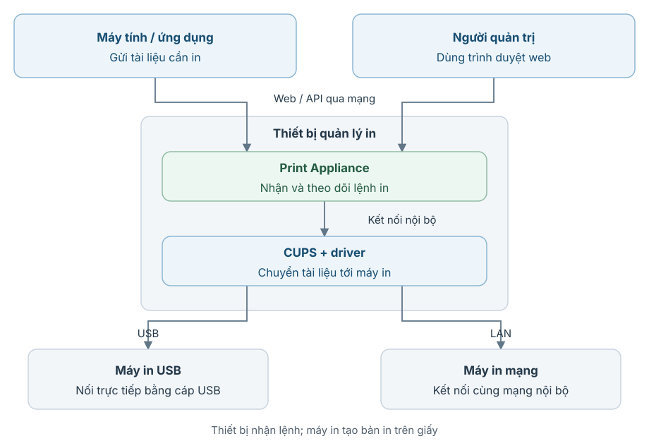

# Print Appliance — Hướng dẫn triển khai và sử dụng

Tài liệu dành cho kỹ thuật viên cài mới Print Appliance trên thiết bị đã có Debian 12, kết nối mạng và SSH. Quy trình đi từ cài phần mềm đến cấu hình máy in, in thử và tích hợp ứng dụng.

<h2 id="table-of-contents" class="front-title">Mục lục</h2>

<!-- BEGIN MAIN TOC -->
- [1. Kiến trúc và luồng in](#1-kien-truc-va-luong-in)
- [2. Yêu cầu trước khi triển khai](#2-yeu-cau-truoc-khi-trien-khai)
- [3. Cài phần mềm trên thiết bị](#3-cai-phan-mem-tren-thiet-bi)
- [4. Cấu hình máy in và kiểm tra in thử](#4-cau-hinh-may-in-va-kiem-tra-in-thu)
- [5. Chức năng và tích hợp API](#5-chuc-nang-va-tich-hop-api)
- [6. Vận hành và xử lý lỗi cơ bản](#6-van-hanh-va-xu-ly-loi-co-ban)
<!-- END MAIN TOC -->

<a name="1-kien-truc-va-luong-in" class="heading-anchor"></a>

## 1. Kiến trúc và luồng in

Print Appliance chạy trên một thiết bị Linux trong mạng nội bộ. Ứng dụng gửi file tới thiết bị; người quản trị dùng trình duyệt để quản lý máy in, quyền truy cập và các lệnh đã nhận.

- **Print Appliance** xác thực yêu cầu, lưu file và lệnh in, điều phối hàng đợi và theo dõi kết quả.
- **CUPS** là hệ thống in trên Linux, quản lý driver và truyền dữ liệu tới máy in. Driver là phần mềm xử lý dữ liệu phù hợp với từng loại máy.
- **Client** là ứng dụng được cấp khóa truy cập, có thể gửi file qua API hoặc trang web `/client`. API là giao diện để phần mềm khác gọi chức năng của Print Appliance.



Máy in nối qua USB hoặc mạng LAN. CUPS chạy cùng thiết bị với Print Appliance; không cần máy chủ CUPS riêng. Odoo có thể là một client, không phải thành phần bắt buộc.

Lệnh và file được lưu trên thiết bị trước khi báo đã nhận. Trạng thái hoàn thành do CUPS báo không bảo đảm giấy đã ra; lệnh chưa rõ kết quả cần kiểm tra thủ công, không tự in lại.

<a name="2-yeu-cau-truoc-khi-trien-khai" class="heading-anchor"></a>

## 2. Yêu cầu trước khi triển khai

| Thành phần | Yêu cầu |
| --- | --- |
| Thiết bị | EDATEC/Raspberry Pi ARM64, nguồn ổn định, đủ chỗ cho file chờ in |
| Hệ điều hành | Debian 12 ARM64, Python 3.11; đã có mạng và SSH |
| Tài khoản Linux | Đăng nhập SSH được và có quyền `sudo` |
| Mạng | IP cố định hoặc DHCP reservation; có Internet trong lúc tải gói cài đặt |
| Máy in | Kết nối USB/LAN và có driver Linux tương thích ARM64 |
| Máy kỹ thuật viên | Terminal/PowerShell để SSH, trình duyệt để cấu hình web |

Dung lượng cần tùy số lệnh và kích thước file; chưa có mức CPU/RAM tối thiểu được đo kiểm cho mọi tải. Sau khi cài, web và API hoạt động trong LAN, không cần Internet.

Chuẩn bị IP thiết bị, thông tin máy in và một PDF ngắn để thử. ZPL là dữ liệu lệnh cho một số máy in nhãn; chỉ chọn khi máy hỗ trợ. Mọi địa chỉ ví dụ trong tài liệu phải được thay bằng thông tin thực tế.

<a name="3-cai-phan-mem-tren-thiet-bi" class="heading-anchor"></a>

## 3. Cài phần mềm trên thiết bị

Quy trình này dành cho **bản cài mới**. Nếu `/opt/print-appliance` hoặc `/var/lib/print-appliance` đã tồn tại, dừng và dùng [quy trình cập nhật](git-deployment.md). Không xóa thư mục để chạy lại từ đầu.

Chạy lần lượt từng nhóm lệnh; chỉ chuyển bước khi lệnh trước thành công. `sudo` thực hiện thao tác với quyền quản trị Linux. Ví dụ xuyên suốt bên dưới dùng thiết bị EDATEC có tài khoản Linux `pi`, hostname `raspberrypi` và IP LAN `192.168.0.123`. Đây là thông tin minh họa, không phải cấu hình mặc định bắt buộc; thay bằng thông tin thiết bị của bạn nếu khác.

<a name="31-ang-nhap-thiet-bi" class="heading-anchor"></a>

### 3.1 Đăng nhập thiết bị

**Chạy trên máy cá nhân** bằng Terminal hoặc PowerShell:

```sh
ssh pi@raspberrypi
```

Nếu máy cá nhân không tìm thấy hostname `raspberrypi`, dùng IP của thiết bị thay thế (chỉ cần chọn một trong hai cách):

```sh
ssh pi@192.168.0.123
```

Nhập mật khẩu Linux của tài khoản `pi` khi được hỏi. Mật khẩu này dùng để SSH, không phải mật khẩu quản trị web được tạo ở bước 3.3.

Lần đầu kết nối, đối chiếu dấu nhận diện SSH với người quản lý thiết bị. Sau khi đăng nhập, **mọi lệnh ở các bước tiếp theo chạy trong phiên SSH trên Debian**, trừ khi có ghi khác.

Kiểm tra môi trường trước khi cài:

```sh
cat /etc/os-release
uname -m
python3 --version
```

**Kết quả cần đạt:** Debian 12, kiến trúc `aarch64` và Python 3.11. Nếu khác, cần kiểm tra tương thích trước khi tiếp tục.

<a name="32-tai-ma-nguon" class="heading-anchor"></a>

### 3.2 Tải mã nguồn

Chạy trong phiên SSH trên EDATEC:

```sh
sudo apt-get update
sudo apt-get install git
git clone https://github.com/luongnguyen008/printer-server.git
cd printer-server
```

**Kết quả cần đạt:** bạn đang ở thư mục `printer-server` chứa `install.sh`. Script cài đúng commit vừa clone; không cần tự tạo môi trường Python hay tài khoản dịch vụ. Không sửa file trong checkout trước khi cài.

<a name="33-cai-ung-dung" class="heading-anchor"></a>

### 3.3 Cài ứng dụng

```sh
sudo ./install.sh
```

Khi được hỏi:

1. Nhập IP của EDATEC, ví dụ `192.168.0.123`. Nhấn Enter nếu chỉ muốn truy cập tại thiết bị (`127.0.0.1`). IP phải đang được gán cho thiết bị; nên đặt IP cố định hoặc DHCP reservation.
2. Kiểm tra thông tin, nhập `y` để xác nhận.
Script đặt mật khẩu quản trị web ban đầu là **`admin12345678`**. Đây không phải mật khẩu SSH của `pi`; chỉ áp dụng cho bản cài mới.

Script tự cài CUPS và thư viện Python, tạo tài khoản `print-appliance`, đặt mã nguồn trong `/opt/print-appliance/source`, dữ liệu tại `/var/lib/print-appliance`, rồi đăng ký dịch vụ. Ứng dụng chạy bằng tài khoản riêng, không chạy bằng root. Driver từng model máy in vẫn cài riêng ở mục 4.

**Kết quả cần đạt:** thông báo `Installed` và lệnh khởi động. Script bật tự khởi động cùng thiết bị nhưng chưa chạy ứng dụng ngay. Nếu đã có bản cài hoặc tài khoản dịch vụ, script dừng để bảo vệ dữ liệu. Nếu cài lỗi giữa chừng, kiểm tra lỗi và phần đã cài; không xóa dữ liệu để thử lại.

<a name="34-khoi-ong-va-mo-trang-web" class="heading-anchor"></a>

### 3.4 Khởi động và mở trang web

Chạy một lệnh:

```sh
sudo systemctl start print-appliance
```

Trên máy cá nhân, mở `http://192.168.0.123:8081/` và đăng nhập bằng mật khẩu **`admin12345678`**. Sau lần đăng nhập đầu tiên, vào **Cấu hình → Đổi mật khẩu quản trị** để đổi ngay; mật khẩu mặc định là thông tin công khai. Trang gửi file là `http://192.168.0.123:8081/client`.

**Kết quả cần đạt:** mở được trang quản trị. Nếu không, kiểm tra trên EDATEC:

```sh
systemctl is-active print-appliance cups
sudo journalctl -u print-appliance -n 50 --no-pager
```

Hai dịch vụ cần báo `active`. Nếu dịch vụ chạy nhưng không mở được web, kiểm tra IP và firewall: chỉ cho phép TCP `8081` từ các máy cần dùng. Chọn `127.0.0.1` khi cài thì máy khác không thể truy cập trực tiếp.

HTTP không được mã hóa: chỉ dùng trong LAN tin cậy, không mở trực tiếp ra Internet. Với mạng không tin cậy, dùng HTTPS qua reverse proxy theo [hướng dẫn vận hành](operations.md).

<a name="4-cau-hinh-may-in-va-kiem-tra-in-thu" class="heading-anchor"></a>

## 4. Cấu hình máy in và kiểm tra in thử

Thực hiện trên trình duyệt sau khi đăng nhập trang quản trị. Mục tiêu là kiểm tra đủ chuỗi: ứng dụng nhận lệnh → CUPS chuyển dữ liệu → máy in ra giấy.

<a name="41-cai-driver-va-ang-ky-may-in" class="heading-anchor"></a>

### 4.1 Cài driver và đăng ký máy in

Trước khi đăng ký, cài driver Linux đúng model và kiến trúc ARM64 theo hướng dẫn nhà sản xuất, nếu CUPS chưa có driver phù hợp. Kiểm tra danh sách driver đã cài bằng lệnh sau **trên thiết bị qua SSH**:

```sh
lpinfo -m
```

**Kết quả cần đạt:** tìm thấy driver phù hợp. Không có một lệnh cài driver chung cho mọi máy. File PPD mô tả khả năng và tùy chọn của máy; một PPD riêng lẻ không thay thế các bộ lọc hoặc thư viện mà driver cần.

> **Ví dụ:** Canon LBP6230dw đã in PDF ra giấy với driver Canon UFRII LT ARM64. Đây không phải model hay driver bắt buộc.

Tiếp theo, đăng ký máy trên web:

1. Mở trang quản trị và đăng nhập bằng mật khẩu được cấp.
2. Vào **Máy in → Thêm máy in → Cấu hình máy mới**.
3. Đặt tên dễ nhận biết, ví dụ “Máy in phòng kho”.
4. Chọn thiết bị được tìm thấy và driver đúng loại máy. Nếu không thấy thiết bị hoặc driver, nhờ kỹ thuật viên kiểm tra; không chọn một driver bất kỳ để thử.
5. Chọn **PDF** cho tài liệu thông thường, rồi bấm **Tạo máy in**.
6. Mở **Sửa cấu hình** nếu cần đặt khổ giấy, in hai mặt hoặc giới hạn các lựa chọn của người gửi.

Nếu máy đã được đăng ký, không cần thêm lại. Lựa chọn **Dùng cấu hình có sẵn** dành cho trường hợp kỹ thuật viên đã tạo hàng đợi trong CUPS; hàng đợi là nơi CUPS giữ các tài liệu chờ chuyển đến máy. Chỉ dùng hàng đợi dành riêng cho Print Appliance. Xác nhận chính sách lỗi CUPS là `stop-printer` trước khi tiếp tục máy nhập từ cấu hình có sẵn.

Nếu máy hiển thị **Đang tạm dừng**, kiểm tra kết nối, giấy và cấu hình rồi bấm **Tiếp tục máy in** khi đã sẵn sàng. Thao tác này có thể cho các lệnh đang chờ chạy.

<a name="42-cap-khoa-cho-ung-dung-gui-in" class="heading-anchor"></a>

### 4.2 Cấp khóa cho ứng dụng gửi in

1. Vào **Clients → Thêm client**, đặt tên dễ nhận biết, chẳng hạn “Ứng dụng phòng kho”.
2. Tích các máy được phép sử dụng, rồi lưu.
3. Sao chép API key ngay khi hiện. Khóa chỉ được hiển thị một lần; chuyển cho người dùng hoặc người lập trình qua kênh an toàn.

Bạn có thể sửa quyền dùng máy mà không đổi khóa. Nếu khóa bị lộ, thu hồi hoặc đổi khóa rồi cập nhật cho bên sử dụng; không chia sẻ mật khẩu quản trị thay cho khóa.

<a name="43-chon-file-va-gui-mot-lenh-in" class="heading-anchor"></a>

### 4.3 Chọn file và gửi một lệnh in

Lần đầu, nên thử một PDF ngắn, chọn một bản và kiểm tra đúng máy trước khi gửi. **Nút gửi có thể làm máy in chạy thật.**

1. Mở trang `/client`, nhập API key rồi bấm **Kết nối**.
2. Chọn máy in trong danh sách. Nếu danh sách trống, nhờ quản trị cấp quyền cho client.
3. Chọn file, kiểm tra định dạng và đặt **Số bản** là `1` cho lần thử.
4. Nhập **Tiêu đề** dễ nhận biết và chọn các tùy chọn cần thiết.
5. Bấm **Gửi lệnh in** một lần. Xem lệnh mới trong phần **Lệnh của client** và lưu mã lệnh nếu cần nhờ hỗ trợ.
6. Chờ trạng thái cập nhật và kiểm tra bản in trên giấy. Khi xong, bấm **Ngắt kết nối**.

<a name="44-xac-nhan-ket-qua" class="heading-anchor"></a>

### 4.4 Xác nhận kết quả

| Trạng thái trên trang gửi file | Bạn nên làm gì? |
| --- | --- |
| Đang chờ / Đang giữ | Chờ đến lượt; nếu đang giữ lâu, nhờ quản trị đọc lý do |
| Đang giao / Đã giao CUPS | Đang xử lý; tiếp tục chờ, không gửi thêm cùng tài liệu |
| Hoàn thành (CUPS) | Hệ thống in báo hoàn thành; kiểm tra giấy thực tế nếu cần xác nhận |
| Thất bại / Đã hủy | Đọc lý do và kiểm tra phần giấy có thể đã in trước khi quyết định gửi mới |
| Chưa rõ kết quả | Nhờ quản trị kiểm tra lệnh và máy; **không tự in lại** |

**Nếu gửi file rồi mất phản hồi:** giữ nguyên tab, dùng **Gửi lại cùng yêu cầu** nếu nút này xuất hiện. Nút đó gửi lại đúng dữ liệu và mã đang giữ, giúp hệ thống không tạo lệnh trùng. Không đóng hoặc tải lại trang để thử; nếu đã làm vậy, kiểm tra lịch sử và nhờ quản trị xác minh trước khi gửi mới.

**Nếu máy hết giấy hoặc mất kết nối:** sửa nguyên nhân trước, sau đó quản trị kiểm tra và cho tiếp tục nếu đang tạm dừng. Máy hết lỗi không có nghĩa các lệnh sẽ tự chạy lại.

**Nếu cần hủy:** nhờ quản trị mở lệnh trong mục **Lệnh in** và yêu cầu hủy. Hủy không thu hồi được giấy đã in; khi tài liệu đã được chuyển tới CUPS, cần chờ hệ thống xác nhận kết quả.


**Điều kiện bàn giao:** in một bản đúng nội dung, đúng máy; kiểm tra tùy chọn cần dùng và quyền client. Trên máy/hàng đợi thử được phép, kiểm tra thêm tạm dừng, tiếp tục và hủy từ web. Có nhóm `lpadmin` hoặc tạo máy thành công chưa chứng minh mọi thao tác CUPS đều hoạt động.

<a name="5-chuc-nang-va-tich-hop-api" class="heading-anchor"></a>

## 5. Chức năng và tích hợp API

Print Appliance quản lý máy in, cấp quyền theo client, nhận file PDF/ZPL, chống gửi trùng và theo dõi/hủy lệnh. Mục này minh họa đủ 5 API dành cho ứng dụng gửi in; API quản trị dùng cơ chế xác thực riêng, xem [đặc tả đầy đủ](api.md).

<a name="51-chuan-bi-goi-api" class="heading-anchor"></a>

### 5.1 Chuẩn bị gọi API

Chạy các ví dụ bằng **Bash trên máy có file cần in** (Linux, macOS hoặc WSL), không bắt buộc SSH vào EDATEC. Cần có `curl`. Ví dụ dùng IP `192.168.0.123`; thay nếu thiết bị dùng địa chỉ khác.

Trong trang quản trị, tạo client và cấp máy in tại **Clients**. Dùng API key của client, không dùng mật khẩu quản trị. Nhập key qua lời nhắc để không ghi key trực tiếp vào lịch sử lệnh:

```sh
BASE_URL='http://192.168.0.123:8081'
read -r -s -p 'API key: ' API_KEY
printf '\n'
```

Mọi request bên dưới gửi header `Authorization: Bearer ...`. Không chia sẻ key hoặc đưa vào URL. HTTP không được mã hóa; chỉ dùng LAN tin cậy hoặc HTTPS. Các ID và JSON phản hồi bên dưới đều là ví dụ, không phải dữ liệu thật của EDATEC.

`curl -i` hiển thị cả mã HTTP và JSON. Các lệnh GET không có body. Chỉ POST gửi file và POST hủy làm thay đổi lệnh in.

<a name="52-danh-sach-may-uoc-cap" class="heading-anchor"></a>

### 5.2 Danh sách máy được cấp

**GET `/api/v1/printers`**

Lấy `id` của máy muốn in và gán `PRINTER_ID=printer-example` (thay bằng ID thật). Mỗi máy có `capabilities.supported` và `capabilities.defaults`. Gửi giá trị từ supported bằng field cùng tên: `paper_size`, `sides`, `color_mode`, `scaling`. Bỏ qua field thì dùng mặc định; null nghĩa là chưa ánh xạ chắc chắn mặc định driver. Không cần gọi API capabilities riêng. Các lựa chọn riêng lẻ vẫn có thể xung đột khi kết hợp; server kiểm tra khi nhận lệnh. Mảng rỗng `[]` nghĩa là client chưa thấy máy nào được cấp. `ready` là trạng thái cho phép xử lý, không chứng minh máy đang có giấy hoặc đang online.

**Request:**

```sh
curl -i "$BASE_URL/api/v1/printers" \
  -H "Authorization: Bearer $API_KEY"
```

**Response HTTP 200 — Danh sách (có thể rỗng).**

```json
[
  {
    "id": "printer-example",
    "name": "Máy in được cấp",
    "formats": [
      "pdf"
    ],
    "status": "ready",
    "pause_reason": null,
    "capabilities": {
      "availability": "available",
      "reason": null,
      "supported": {
        "paper_size": [
          "A4",
          "Letter"
        ],
        "sides": [
          "one-sided",
          "two-sided-long-edge"
        ],
        "color_mode": [
          "monochrome"
        ],
        "scaling": [
          "auto",
          "fit"
        ]
      },
      "defaults": {
        "paper_size": "A4",
        "sides": "one-sided",
        "color_mode": "monochrome",
        "scaling": "auto"
      }
    }
  }
]
```

**Lỗi cần xử lý:** `401`: API key thiếu, sai, đã đổi hoặc đã thu hồi.

<a name="53-gui-yeu-cau-in" class="heading-anchor"></a>

### 5.3 Gửi yêu cầu in

**POST `/api/v1/jobs`**

**Lệnh này có thể in ra giấy thật.** Chuẩn bị `invoice.pdf` trong thư mục hiện tại. `PRINTER_ID` lấy từ bước 5.2; nếu chưa có `uuidgen`, tạo một mã duy nhất 1–128 ký tự gồm chữ, số hoặc `._~-` rồi gán cho `REQUEST_ID`.

Body là `multipart/form-data`, không phải JSON. Cần `file`, `printer_id`, `format` và `title`; ví dụ truyền rõ `copies=1` để dùng mặc định của máy. Số bản trong khoảng 1–100, có thể bị giới hạn thêm theo máy. Muốn đổi khổ giấy từ capabilities trong danh sách máy, thêm `-F 'paper_size=A4'`. Không tự đặt header Content-Type; curl tạo multipart boundary.

Các field tùy chọn PDF:

| Field | Giá trị minh họa | Ý nghĩa |
| --- | --- | --- |
| `paper_size` | `A4` | Khổ giấy |
| `sides` | `one-sided`, `two-sided-long-edge`, `two-sided-short-edge` | Một mặt / hai mặt cạnh dài / cạnh ngắn |
| `color_mode` | `monochrome`, `color` | Trắng đen / màu |
| `scaling` | `auto`, `auto-fit`, `fit`, `fill`, `none` | Tỷ lệ PDF; fill có thể cắt mép |

Chỉ dùng giá trị máy công bố trong `capabilities.supported`. ZPL không nhận các field này. Yêu cầu sai trả 422 với `detail.field`, `detail.allowed`, `detail.message`; tổ hợp sai trả `field=combination`. Không đọc được CUPS hoặc mapping thay đổi trả 503, không tự chọn phương án khác.

**Thay đổi không tương thích:** endpoint capabilities riêng đã bỏ. Field JSON `options` không được dùng cho lệnh mới. Ngoại lệ duy nhất là gửi lại nguyên trạng yêu cầu cũ đã được nhận trước khi cập nhật: hệ thống chỉ trả kết quả chống trùng, không tạo lệnh mới. Không đổi mã yêu cầu để vượt lỗi khi chưa biết bản cũ đã in hay chưa.

HTTP 202 chỉ xác nhận đã lưu lệnh, **không xác nhận giấy đã ra**. Lưu `job_id` để theo dõi.

Nếu mất phản hồi, giữ nguyên mã, file, tên file và mọi tham số; chỉ chạy lại lệnh `curl`, **không chạy lại dòng tạo REQUEST_ID**. Cùng yêu cầu đã nhận trả HTTP 200 với `deduplicated=true`. Không đổi mã để vượt lỗi 409. Nếu `history_expired=true`, lịch sử đã bị dọn nhưng hệ thống vẫn không tạo bản in mới.

**Request:**

```sh
# Tạo mã một lần cho thao tác in mới; giữ lại nếu phải gửi lại.
REQUEST_ID="$(uuidgen)"
curl -i "$BASE_URL/api/v1/jobs" \
  -H "Authorization: Bearer $API_KEY" \
  -H "Idempotency-Key: $REQUEST_ID" \
  -F "printer_id=$PRINTER_ID" \
  -F 'file=@./invoice.pdf;type=application/pdf' \
  -F 'format=pdf' \
  -F 'title=Invoice example' \
  -F 'copies=1'
```

**Response HTTP 202 — Yêu cầu mới được lưu; chưa chứng minh đã in.**

```json
{
  "job_id": "job-example",
  "status": "queued",
  "deduplicated": false
}
```

**Response HTTP 200 — Phát lại cùng key/nội dung; không tạo job mới.**

```json
{
  "job_id": "job-example",
  "status": "queued",
  "deduplicated": true,
  "history_expired": false
}
```

**Lỗi cần xử lý:** `401`: API key thiếu, sai, đã đổi hoặc đã thu hồi.; `403`: Máy không được cấp.; `409`: Key đã dùng với nội dung khác; không đổi key để vượt qua.; `413`: Vượt giới hạn tệp/body.; `422`: Thiếu/sai field, chữ ký PDF/ZPL, format, copies, options hoặc request ID.; `429`: Hàng đợi đầy.; `503`: Không xác minh được capability máy.; `507`: Không đủ đĩa hoặc không lưu được yêu cầu.

<a name="54-lich-su-cua-client" class="heading-anchor"></a>

### 5.4 Lịch sử của client

**GET `/api/v1/jobs`**

`limit` không bắt buộc, mặc định 50 và được giới hạn trong 1–100. Kết quả mới nhất trước, chỉ gồm lệnh của client hiện tại, không trả nội dung file. Mảng rỗng `[]` là chưa có lịch sử hiển thị.

**Request:**

```sh
curl -i "$BASE_URL/api/v1/jobs?limit=50" \
  -H "Authorization: Bearer $API_KEY"
```

**Response HTTP 200 — Danh sách metadata, không trả file đã lưu.**

```json
[
  {
    "job_id": "job-example",
    "printer_id": "printer-example",
    "status": "queued",
    "accepted_at": "2026-10-06T09:00:00+00:00",
    "updated_at": "2026-10-06T09:00:00+00:00",
    "title": "Invoice example",
    "format": "pdf",
    "copies": 1,
    "reason": null
  }
]
```

**Lỗi cần xử lý:** `401`: API key thiếu, sai, đã đổi hoặc đã thu hồi.

<a name="55-chi-tiet-va-su-kien-lenh" class="heading-anchor"></a>

### 5.5 Chi tiết và sự kiện lệnh

**GET `/api/v1/jobs/{job_id}`**

Dùng `job_id` từ kết quả gửi hoặc lịch sử. Gọi lại mỗi 3–5 giây khi cần theo dõi; dừng khi `completed`, `failed` hoặc `canceled`. `completed` là CUPS báo hoàn thành, không bảo đảm giấy đã ra. Với `unknown`, nhờ quản trị xác minh, không tự in lại. `reason` và `events` giúp giải thích trạng thái.

**Request:**

```sh
JOB_ID='job-example' # Thay bằng job_id thật đã nhận
curl -i "$BASE_URL/api/v1/jobs/$JOB_ID" \
  -H "Authorization: Bearer $API_KEY"
```

**Response HTTP 200 — Metadata và events.**

```json
{
  "job_id": "job-example",
  "printer_id": "printer-example",
  "status": "queued",
  "accepted_at": "2026-10-06T09:00:00+00:00",
  "updated_at": "2026-10-06T09:00:00+00:00",
  "title": "Invoice example",
  "format": "pdf",
  "copies": 1,
  "reason": null,
  "events": [
    {
      "at": "2026-10-06T09:00:00+00:00",
      "actor": "client",
      "status": "queued",
      "message": "Accepted durable request"
    }
  ]
}
```

**Lỗi cần xử lý:** `401`: API key thiếu, sai, đã đổi hoặc đã thu hồi.; `404`: Lệnh không tồn tại, không thuộc client hoặc lịch sử đã bị dọn.

<a name="56-yeu-cau-huy-lenh" class="heading-anchor"></a>

### 5.6 Yêu cầu hủy lệnh

**POST `/api/v1/jobs/{job_id}/cancel`**

Không gửi body. HTTP 200 trả trạng thái sau yêu cầu, không bảo đảm luôn là `canceled`. Đọc `status`, `reason`, `events`; nếu cần, gọi lại API chi tiết. Hủy không thu hồi được giấy đã in và không xóa lịch sử.

**Request:**

```sh
curl -i -X POST "$BASE_URL/api/v1/jobs/$JOB_ID/cancel" \
  -H "Authorization: Bearer $API_KEY"
```

**Response HTTP 200 — Trạng thái thực tế sau yêu cầu, không luôn là canceled.**

```json
{
  "job_id": "job-example",
  "printer_id": "printer-example",
  "status": "canceled",
  "accepted_at": "2026-10-06T09:00:00+00:00",
  "updated_at": "2026-10-06T09:00:00+00:00",
  "title": "Invoice example",
  "format": "pdf",
  "copies": 1,
  "reason": "Canceled before CUPS handoff",
  "events": []
}
```

**Lỗi cần xử lý:** `401`: API key thiếu, sai, đã đổi hoặc đã thu hồi.; `404`: Lệnh không tồn tại hoặc không thuộc client.; `503`: Không xác minh được trạng thái CUPS; chưa báo canceled.

Tài liệu API cũng có sẵn khi không có Internet tại `/client#api-guide`; trang hướng dẫn không tự gửi request hoặc in thử.

<a name="6-van-hanh-va-xu-ly-loi-co-ban" class="heading-anchor"></a>

## 6. Vận hành và xử lý lỗi cơ bản

<a name="61-kiem-tra-khi-khong-mo-uoc-web" class="heading-anchor"></a>

### 6.1 Kiểm tra khi không mở được web

Chạy **trên thiết bị qua SSH**:

```sh
systemctl is-active print-appliance cups
sudo journalctl -u print-appliance -n 50 --no-pager
```

Hai dịch vụ cần báo `active`. Log cho biết lỗi khởi động hoặc kết nối; nếu dịch vụ vẫn chạy nhưng máy khác không mở được web, kiểm tra IP lắng nghe, mạng và firewall ở bước 3.4.

<a name="62-quan-ly-mat-khau-va-khoa-truy-cap" class="heading-anchor"></a>

### 6.2 Quản lý mật khẩu và khóa truy cập

Đổi mật khẩu tại **Cấu hình → Đổi mật khẩu quản trị**. Mật khẩu mới ít nhất 12 ký tự; đổi thành công đăng xuất các phiên quản trị nhưng không thay API key.

Nếu quên mật khẩu, chạy trên thiết bị:

```sh
sudo -u print-appliance /opt/print-appliance/.venv/bin/print-appliance admin-password --data-dir /var/lib/print-appliance
```
 Không sửa trực tiếp cơ sở dữ liệu. Nếu API key bị lộ, thu hồi/đổi khóa trong **Clients** rồi cập nhật ứng dụng sử dụng khóa đó.

<a name="63-cap-nhat-va-sao-luu" class="heading-anchor"></a>

### 6.3 Cập nhật và sao lưu

Trước bảo trì, kiểm tra lệnh đang xử lý và chọn thời điểm phù hợp. Không chạy lại quy trình cài mới trên bản đang vận hành; dùng [quy trình cập nhật](git-deployment.md).

Sao lưu cả dữ liệu và file chờ in theo [hướng dẫn vận hành](operations.md), không chỉ sao chép riêng SQLite đang chạy. Trước khi phục hồi, đối chiếu các lệnh phát sinh sau bản sao để tránh in lại. Giữ nguyên hàng đợi và driver CUPS khi chỉ cập nhật ứng dụng.
